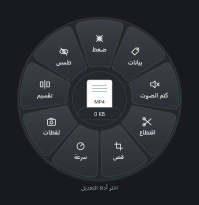
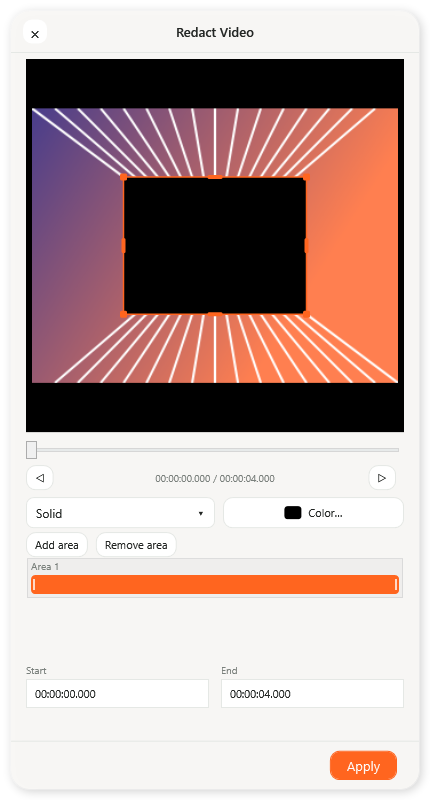

# MadarDrop · مدار دروب

Local file conversion and editing for Windows, with a wheel that follows your drag.
Arabic and English. Light and dark appearance. Independent community project.


0.4.4 adds **JOIN** for multiple videos. Arrange, add or remove clips, preview the
first frame, choose output size and keep or mute sound. Export writes one new MP4.
The previous nine single-video tools, media metadata, PDF page exports and saved
language/appearance/behavior preferences remain available.

[Video joining notes](docs/VIDEO-JOIN-0.4.4.ar.md) explain output behavior and limits.
[Other video tools](docs/VIDEO-TOOLS-0.4.3.ar.md) remain documented separately.

**[Download for Windows](https://github.com/Mohivx/MadarDrop/releases/latest)** · [العربية](README.ar.md)





## Install or update

Windows 10/11 **x64**, .NET Framework **4.8**. Run `MadarDrop-Setup-0.4.4.exe` from Releases.
The installer detects registered installations, running legacy previews, and adjacent portable
preview folders. It offers **Update**, **Repair**, or a fresh per-user **Install**. You can select
an existing folder manually. No administrator privileges are needed. Updates stay in the same folder,
preserve unmanaged files and preferences, and keep a ZIP backup. Failed file updates roll back.
Save your work first: the selected application is closed during replacement.

The app appears in Windows Installed apps and the Start menu. A desktop shortcut is optional.
Uninstall removes only unmodified files recorded by the installer; converted files, modified files,
settings and backups stay on disk. It may leave the installation folder behind.

Image editing and PDF tools include their runtime. Media conversions require FFmpeg. Existing
copies beside the app or on PATH are used; otherwise choose **Settings → Set up media tools**
to download directly from Gyan.dev or select your own `ffmpeg.exe`. Downloads are verified against
the provider's SHA-256 checksum. FFmpeg is **not bundled** in the public installer or source archive.
Conversion itself works offline once the tools are available.

## Use

1. Drag a file from Explorer or the desktop, then press **Shift** for the format wheel.
2. Keep dragging and press **Alt** for editing tools, or **Ctrl** for file actions.
3. Drop on an action. **Esc** dismisses the wheel. Its center opens additional tools.

Crop opens a compact floating editor near the drop location. Photo tools put the preview above their
controls. Video crop lets you drag a region, choose an aspect ratio, change its dimensions as a
percentage and seek the frame preview. Seeking previews the crop across time; export crops the full
recording and retains audio. Very small/odd crops normalize to even pixels for encoding. Conversion
progress appears near the drop, with cancellation and an output link; errors stay visible.
**MUTE** removes audio without re-encoding the video. It keeps the source container and non-audio
tracks, writes a new `(muted)` copy and leaves the original intact. The popup close control cancels
an active operation; clicking its saved message shows the result in Explorer.
For PDFs, choose JPG or PNG from the format wheel; **Tools → SPLIT** saves each page as a PDF.
For multiple videos, choose **Tools → JOIN**. Reorder the list, select up to 720p, 1080p
or 4K, and save a joined MP4 beside the first clip in the final order.
For a single video, **Tools → SNAPSHOT** opens the preview. Move the timeline, add frames, remove
unwanted thumbnails and save up to 50 selected frames as PNGs. Frame buttons use the stream frame rate;
variable-rate recordings may repeat or skip a frame when stepping.
Open the main app from its tray icon for preferences. **Check for updates** in Settings manually
checks this repository's latest stable release and opens its download page.

- Image conversion; crop, resize, rotation, adjustments, drawing, text, backgrounds and collage.
- Flattened image redaction with solid covers or pixelation; exports do not carry original EXIF.
- PDF pages to JPG/PNG at 300 DPI; split each page into its own PDF; thumbnails, reorder, rotate, duplicate, delete, combine and stream compression.
- Image/PDF metadata inspection, editing and stripping; lossless remuxing for audio/video tags.
- Audio/video conversion, compression and mute; visual video trim/crop/speed, PNG snapshots, custom/equal splitting, timed solid/blur redaction and ordered video joining using FFmpeg.
- Subtitles, text/DOCX, CSV/TSV/XLSX values, ZIP creation/extraction and file actions.

## Limits

This is a **0.4.3 preview**, not feature parity with any commercial app. No OCR, PDF-to-Office,
PDF page-text editing, face detection, advanced timeline editor, RAR/TAR/GZIP, nearby sharing
or floating file shelf. Encrypted PDFs must be unlocked first. Editing invalidates document
signatures. Image editing exports a still image (up to 64 megapixels); animated metadata editing
is rejected to avoid losing frames. PDF editing and exports support up to 300 pages per session; rendered pages are limited to 64 megapixels each. Spreadsheet
conversions preserve values rather than full workbook formatting and formulas. The installer is unsigned.

## Build

Use Windows x64, .NET Framework 4.8 and standard **CPython 3.12 x64** with pip.
The C# compiler/WPF assemblies come with .NET Framework; Visual Studio and Inno Setup are not needed.

```powershell
python -m pip install -r requirements-build.txt
.\build.ps1 -PythonExe python.exe
.\updater\build-setup.ps1
```

Output: `MadarDrop-Setup-0.4.4.exe`. Keep `runtime` beside the uninstalled app build.
`build.ps1 -IncludeMedia` is for local experiments; the public setup builder refuses payloads
containing `ffmpeg.exe`. See [THIRD-PARTY.txt](THIRD-PARTY.txt).

The installer source is in `updater/`. Internal `TangerineWindows.exe`, namespaces, settings and
singleton names retain the early local-preview identity for update compatibility. They do not
indicate an official relationship with Tangerine.

## Verify

```powershell
.\release-0.4.4\TangerineWindows.exe --self-test C:\Temp\MadarDrop-core-new
.\release-0.4.4\TangerineWindows.exe --test-editors C:\Temp\MadarDrop-editors-new
.\release-0.4.4\TangerineWindows.exe --test-workflow C:\Temp\MadarDrop-workflow-new
.\release-0.4.4\TangerineWindows.exe --test-crop C:\Temp\MadarDrop-crop-new
.\release-0.4.4\TangerineWindows.exe --test-video-crop C:\Temp\MadarDrop-video-new
.\release-0.4.4\TangerineWindows.exe --test-mute C:\Temp\MadarDrop-mute-new
.\release-0.4.4\TangerineWindows.exe --test-pdf-export C:\Temp\MadarDrop-pdf-export-new
.\release-0.4.4\TangerineWindows.exe --test-snapshot C:\Temp\MadarDrop-snapshot-new
.\release-0.4.4\TangerineWindows.exe --test-video-tools C:\Temp\MadarDrop-video-tools-new
.\release-0.4.4\TangerineWindows.exe --test-tool-models C:\Temp\MadarDrop-tool-models-new
.\MadarDrop-Setup-0.4.4.exe --test-package C:\Temp\MadarDrop-setup-new
```

Each test requires a new directory. Media tests require FFmpeg on PATH or beside the build.
Installer tests use an isolated folder, do not register an installation and do not stop the running app.
CI builds the app/installer and tests the editor, workflow, crop, installer and long paths.
See [release validation](docs/VALIDATION.md).

## Privacy and provenance

Files are processed locally, with no telemetry/cloud conversion. Network requests occur only for
user-requested media downloads or manual update checks, contacting Gyan.dev/GitHub. These requests
disclose normal connection metadata, not file contents.

MadarDrop is an independent, AI-assisted implementation inspired by publicly demonstrated drag-and-drop
file tools, including Tangerine for Mac. It is **not an official Windows port**, is not affiliated with
Leap Studio, and contains no Tangerine proprietary source code, screenshots or packaged assets.
The name and lemon mark are independent. MIT covers our application and installer source; dependencies
retain their licenses. This does not provide legal clearance for interface similarities or third-party
marks. See [publishing notes](PUBLISHING.md).
